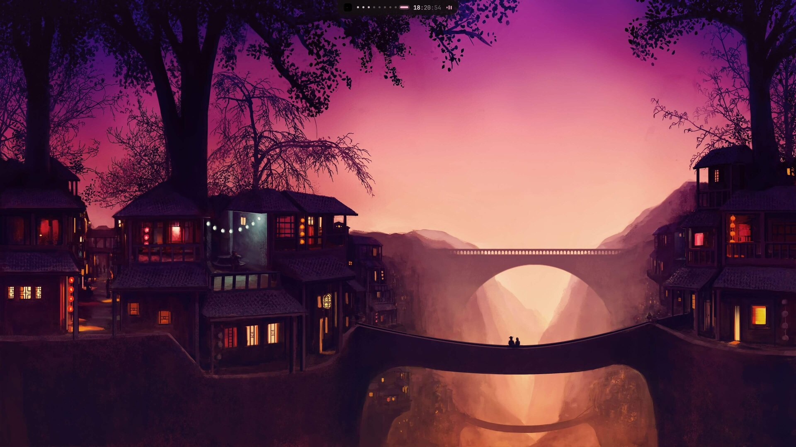
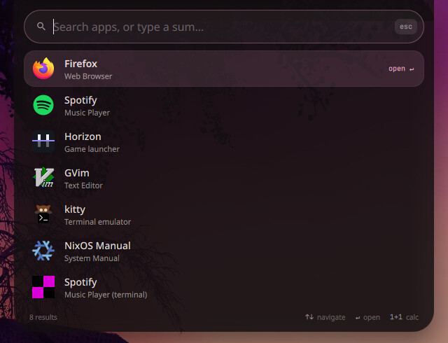
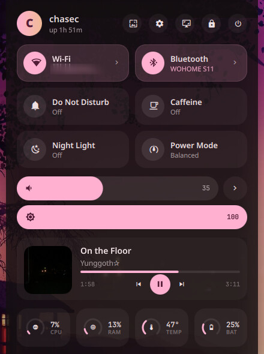
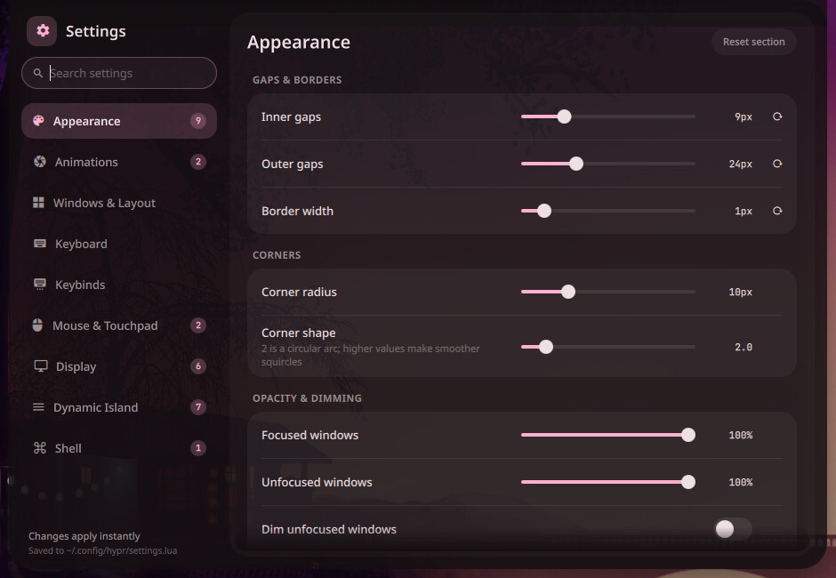
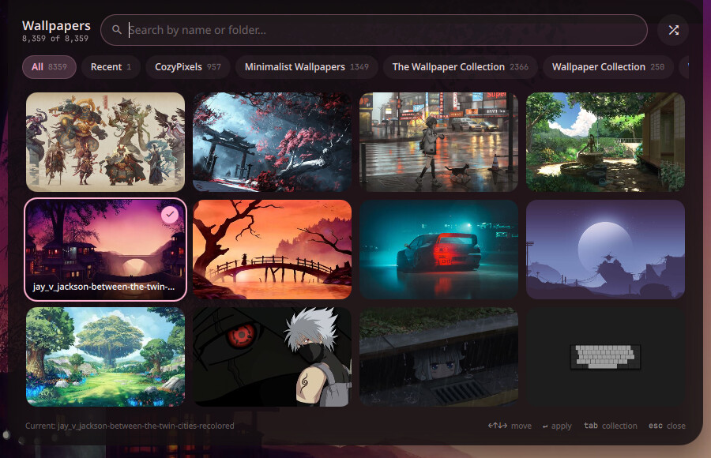
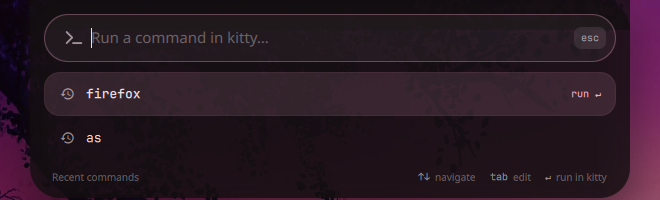

# nixos-config

My NixOS + Hyprland setup. The main thing here is the bar, which isn't really
a bar: it's one little pill at the top of the screen that stretches into
whatever I need (launcher, control center, settings, wallpaper picker) and
then shrinks back. Think iPhone dynamic island, but for a desktop.

Everything is declarative, so this repo *is* my whole system. Built with
[Quickshell](https://quickshell.outfoxxed.me), themed by
[matugen](https://github.com/InioX/matugen) off whatever wallpaper is up.



<sub>Wallpaper: *Between the Twin Cities* by Jay V. Jackson (recolored).</sub>

---

## The island

Most of the time it just sits there showing workspaces, the clock, and a
little equalizer when music is playing.

<p align="center"></p>

The workspace dots go from 1 up to the highest one you're using, so if you
jump from 1 to 4, you'll see 2 and 3 as faint empty slots instead of the dots
shuffling around. Hover it and it peeks open with media controls.

Volume and brightness show up in the island itself instead of a separate popup:

<p align="center"></p>

### Launcher (`Super+D`)

Fuzzy app search. Apps you open a lot float to the top. Type a sum like
`12*7` and it'll just answer it (Enter copies the result).

<p align="center"></p>

### Control center (`Super+A` or click the island)

Wi-Fi, Bluetooth, DND, caffeine, night light, power profiles, volume,
brightness, now playing, system stats and notifications. Wi-Fi, Bluetooth
and sound each have their own page inside it.

<p align="center"></p>

### Settings (`Super+I`)

A real settings app for Hyprland: gaps, borders, rounding, animations,
keyboard, touchpad, monitors, the island itself, and a keybind editor where
you just press the new combo. Changes apply instantly and get saved to
`~/.config/hypr/settings.lua`, so they survive rebuilds.

<p align="center"></p>

### Wallpapers (`Super+Shift+W`)

Browses everything in `~/Pictures/Wallpapers`, grouped by folder, with search.
Picking one re-themes the whole system (island, Hyprland borders, kitty, lock
screen) to match. `Super+W` picks a random one.

<p align="center"></p>

### Run a command (`/` on an empty workspace)

On an empty workspace, hit `/` and the island turns into a command box. Enter
opens kitty, runs it, and leaves you at a prompt so the output doesn't
disappear. It remembers what you ran before. On a workspace with windows `/`
types normally, so it never gets in the way.

<p align="center"></p>

### Draw a terminal

Hold `Super` and drag on an empty bit of desktop to draw a box, and a
floating kitty opens exactly there. Right-click mid-drag to cancel.

---

## Keybinds

| Keys | What it does |
|---|---|
| `Super + D` / `Super + Space` | Launcher |
| `Super + A` | Control center |
| `Super + I` | Settings |
| `Super + Shift + W` | Wallpaper picker |
| `Super + W` | Random wallpaper |
| `/` (empty workspace) | Run a command |
| `Super + Return` / `Super + T` | Terminal (kitty) |
| `Super + Shift + S` | Screenshot a region to clipboard |
| `Super + Q` | Close window |
| `Super + V` | Toggle floating |
| `Super + F` | Fullscreen |
| `Super + 1–0` | Switch workspace |
| `Super + Shift + 1–0` | Move window to workspace |
| `Super + L` | Lock |
| `Super + Shift + E` | Power menu |

All of these can be changed from Settings › Keybinds.

## What's in it

- **WM:** Hyprland (Lua config)
- **Shell/bar:** Quickshell, all custom QML
- **Colors:** matugen, generated from the wallpaper
- **Terminal:** kitty + fish
- **Lock / idle:** hyprlock + hypridle
- **Login:** greetd + tuigreet
- **Font:** JetBrains Mono Nerd Font, Noto Sans
- **Cursor:** Bibata

```
flake.nix                    inputs + the one system output
configuration.nix            system level stuff
home/
  chasec.nix                 home-manager entry
  hyprland.nix               Hyprland config + binds
  matugen.nix                theming + the set-wallpaper script
  kitty.nix, lockscreen.nix
  quickshell.nix             puts home/quickshell into ~/.config
  quickshell/
    Island.qml               the island and all its states
    widgets/                 launcher, control center, settings, ...
    services/                audio, network, media, battery, ...
```

## Trying it yourself

This is my personal config, so it's set up for my laptop and my username.
You'll want to change a few things before using it:

```sh
git clone https://github.com/fruttibarr/nixos-config ~/nixos-config
cd ~/nixos-config

# use your own hardware config, not mine
cp /etc/nixos/hardware-configuration.nix .

# swap "chasec" for your username in flake.nix, configuration.nix,
# and rename home/chasec.nix

git add -A        # flakes ignore files git doesn't know about
sudo nixos-rebuild switch --flake .#nixos
```

Wallpapers aren't included. Drop some in `~/Pictures/Wallpapers` and hit
`Super+W`.

If you only want the island, `home/quickshell/` is the whole thing, but it
expects Hyprland and reads its colors from a matugen-generated `Colors.qml`.

## Credits

- [Quickshell](https://quickshell.outfoxxed.me) by outfoxxed
- [matugen](https://github.com/InioX/matugen)
- [Hyprland](https://hyprland.org)
- Wallpaper by Jay V. Jackson
